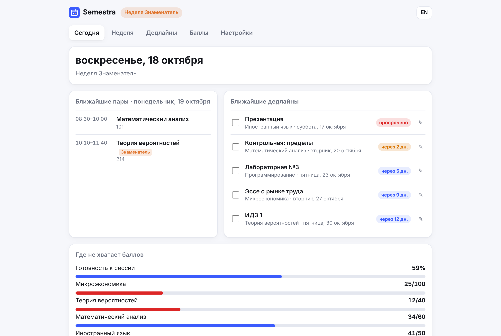
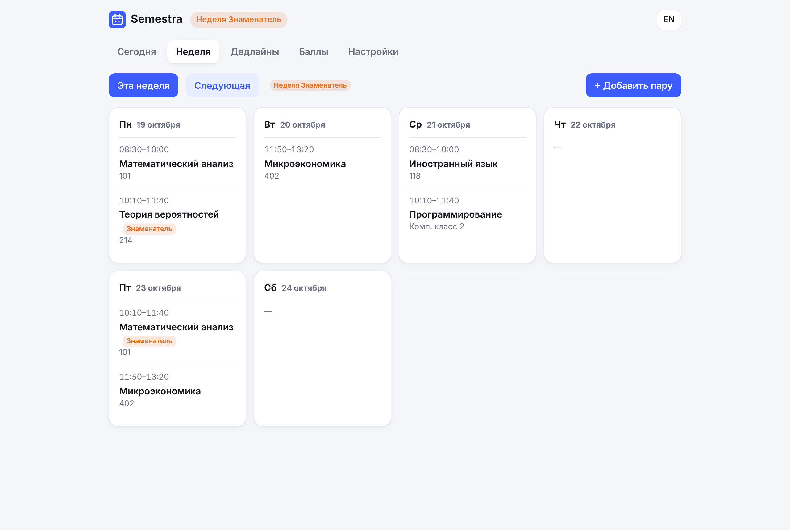
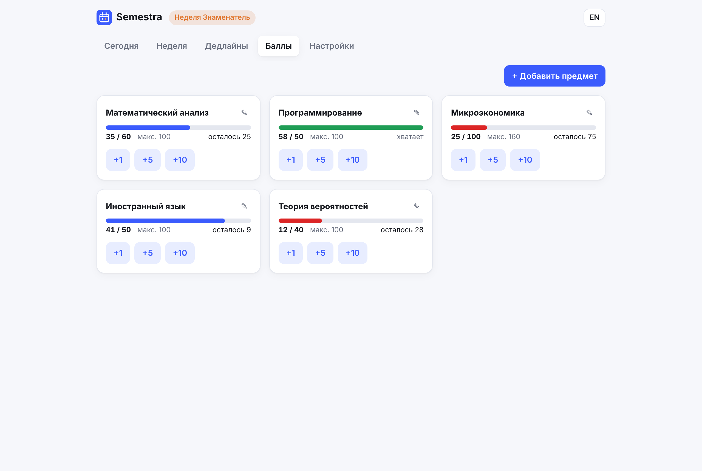
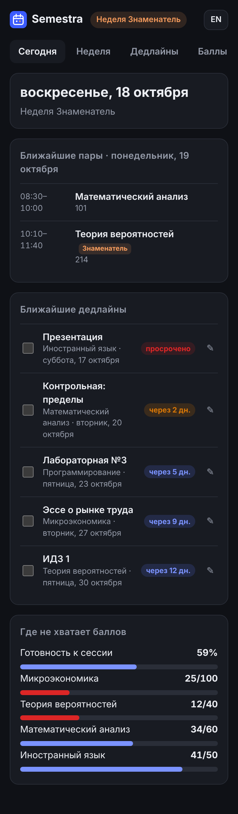

# Semestra

[Русский](#русский) · [English](#english)

**[▶ Try it online](https://eeeeeeeert3103-create.github.io/semestra/)** · no install, no sign-up

**Semester planner for university students.** Alternating weeks (odd/even, «числитель/знаменатель»), deadlines and the points you still need to pass, in one page that works offline. No account, no server, no tracking.

## English

### Why
University timetables often alternate every other week, grades are counted in points, and deadlines live in five different chats. Calendar apps handle none of that well. Semestra does exactly three things:

- **Timetable with alternating weeks.** Mark a class as every week, week A or week B; the app always knows which week it is.
- **Deadlines** with "overdue / today / in N days" badges.
- **Points to pass.** For each subject: earned, needed, maximum, and how many are left. Quick +1/+5/+10 buttons.

Plus: export to any calendar (`.ics`, recurring events), JSON backup and restore, RU/EN interface, dark mode, mobile layout, installable as a PWA.

### Use it
[Open the online version](https://eeeeeeeert3103-create.github.io/semestra/), or download the repo and open `index.html` in a browser. That's it: no build step, no `npm install`.
To host your own copy, fork the repo and enable **GitHub Pages** (Settings → Pages → Deploy from branch → `main` / root).

### Privacy and security
- Everything is stored in your browser's `localStorage`. Nothing is sent anywhere: the page makes **zero network requests**.
- Strict Content-Security-Policy: no inline scripts, no third-party code, no `eval`.
- User text is never inserted as HTML (DOM is built with `textContent`), so pasted `<script>` stays plain text.
- Imported backups are validated field by field; unknown fields are dropped.

### Contributing
Ideas that would help most: timetable import from university schedule portals, more languages, a GPA/grade calculator. Open an issue or a PR.

## Русский

**Планировщик семестра для студентов.** Расписание по числителю и знаменателю, дедлайны и баллы до зачёта или автомата на одной странице. Работает без интернета, без регистрации и без сервера.

- **Расписание с чередованием недель.** Пара бывает каждую неделю, только по числителю или только по знаменателю, а приложение само знает, какая сейчас неделя.
- **Дедлайны** с метками «просрочено», «сегодня», «через N дн.».
- **Баллы.** По каждому предмету видно, сколько набрано, сколько нужно и сколько осталось. Кнопки +1/+5/+10.
- Экспорт в Google/Яндекс/Apple Календарь (`.ics`), резервная копия в JSON, тёмная тема, мобильная версия.

**Как запустить:** [открыть онлайн](https://eeeeeeeert3103-create.github.io/semestra/) или скачать и открыть `index.html` в браузере. Чтобы получить свою ссылку, сделай форк и включи GitHub Pages.

**Данные** хранятся только в твоём браузере, страница не делает ни одного сетевого запроса.

  
  

## License
[MIT](LICENSE)
